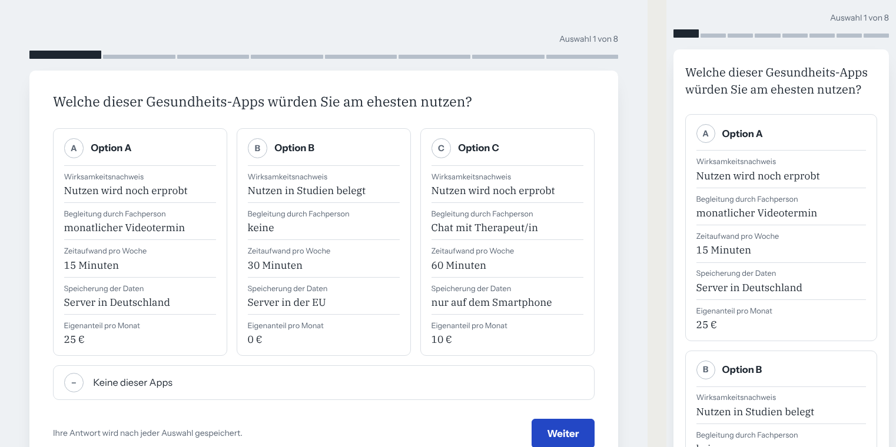
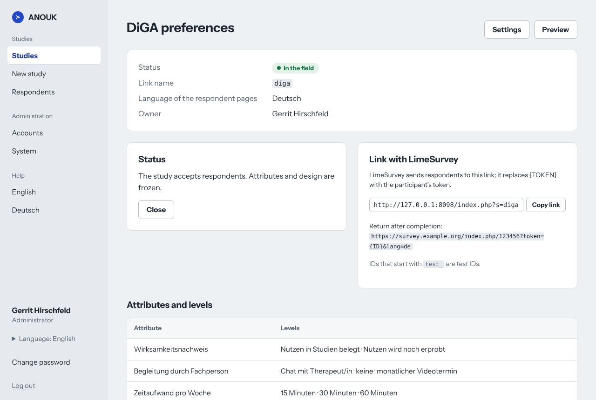
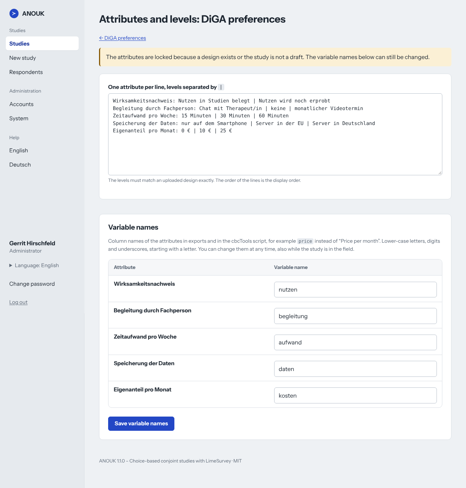

# ANOUK – Choice-based-Conjoint-Studien für LimeSurvey und andere Umfragetools

 

**A**uswahlbasierte **N**utzenmessung: **O**nline-**U**msetzung & **K**alkulation. ANOUK zeigt Befragten die Choice-Tasks einer Choice-based-Conjoint-Studie (CBC), deren Choice-Sets in R mit `cbcTools` geplant wurden. Die Befragten kommen mit ihrer ID aus einem Umfragetool wie LimeSurvey, beantworten die Choice-Tasks und kehren in dieselbe Umfrage zurück. ANOUK läuft auf gewöhnlichem Webspace mit PHP und MySQL.

English version: `README.md`



## Funktionen

- **Choice-Sets aus R:** ANOUK erstellt aus den Attributen einer Studie ein `cbcTools`-Skript; die erzeugte CSV wird hochgeladen und zeilengenau geprüft
- **Umfragetools:** Befragte kommen mit ihrer ID aus LimeSurvey, SoSci Survey, Unipark oder Qualtrics und werden mit derselben ID zurückgeschickt
- **Versionen:** Jede neue ID erhält die am wenigsten genutzte Version des Designs; Versionen von Abbrechenden werden nach einer einstellbaren Zeit wieder frei
- **Exporte:** Langformat für `logitr`, `mlogit` und `bayesm`, Breitformat zum Zusammenführen mit den Umfragedaten und ein Codebuch
- **Variablennamen:** kurze, R-taugliche Spaltennamen je Attribut (`preis` statt „Preis pro Monat“), jederzeit änderbar
- **Konten:** ein Master-Admin und beliebig viele Projektleitungen, die jeweils nur ihre eigenen Studien sehen
- **Sprachen:** Verwaltung und Befragtenseiten auf Englisch und Deutsch; weitere Sprachen über eine zusätzliche Datei
- **Updates:** Datenbankänderungen neuer Versionen laufen per Knopfdruck, ohne Shell

## Voraussetzungen

- PHP 8.1 oder neuer mit `pdo_mysql` und `mbstring`
- MySQL 5.7+ oder MariaDB 10.3+
- Gewöhnlicher Webspace (Apache) genügt – kein Shell-Zugang, kein Composer, kein Node.js
- HTTPS wird dringend empfohlen

## Installation (Webspace)

1. Das aktuelle Release-ZIP von der Releases-Seite herunterladen und entpacken.
2. Den Ordner per FTP hochladen, z. B. nach `https://ihre-domain.de/anouk/`. Die `.htaccess`-Dateien mit hochladen (es sind versteckte Dateien).
3. Im Kundenmenü des Providers eine leere MySQL-Datenbank anlegen und Host, Name, Benutzer und Passwort notieren. Die Datenbank darf auch Tabellen anderer Software enthalten.
4. `https://ihre-domain.de/anouk/install.php` aufrufen und den Schritten folgen:
   - Datenbankdaten eintragen und **Verbindung testen** – die Seite meldet, ob die Verbindung steht, ob der Benutzer Tabellen anlegen darf und ob schon eine ANOUK-Datenbank existiert;
   - das **Tabellenpräfix** `anouk_` beibehalten, außer es sollen zwei ANOUK-Installationen in einer Datenbank laufen;
   - Name, E-Mail-Adresse und Passwort (mindestens 10 Zeichen) des Master-Admins eintragen und **Installieren** klicken;
   - den **Notfallcode** von der Erfolgsseite notieren.
5. `install.php` vom Server löschen (die Erfolgsseite hat dafür einen Knopf).
6. Unter `https://ihre-domain.de/anouk/admin/` anmelden.

Kann der Installer `config.php` nicht schreiben, zeigt er den Inhalt der Datei an; diese dann per FTP neben `index.php` anlegen. Nach der Installation sperrt die Datei `data/install.lock` den Installer.

### nginx

nginx beachtet keine `.htaccess`-Dateien. Diese Regeln in den Server-Block aufnehmen (`/anouk/` an den eigenen Ordner anpassen):

```
location ~ ^/anouk/(src|sql|data|lang|tests)/ { deny all; }
location ~ ^/anouk/(config\.php|.*\.md|.*\.cff|LICENSE)$ { deny all; }
```

Auch ohne diese Regeln geben `config.php` und die PHP-Dateien in `src/` beim direkten Aufruf nichts aus.

### Konfiguration zurücksetzen

Um ANOUK neu einzurichten, z. B. nach einer Änderung des Datenbankpassworts, wird `config.php` gelöscht. Studien, Konten und Antworten bleiben in der Datenbank; der Installer erkennt die bestehende Datenbank.

- **Als Master-Admin:** *System → config.php löschen* (dafür muss `install.php` auf dem Server liegen).
- **Ohne Anmeldung**, z. B. wenn die Datenbank nicht mehr erreichbar ist: `install.php` aufrufen und den Notfallcode eingeben.
- **Per FTP:** `config.php` und `data/install.lock` löschen.

## Aktualisieren

1. Datenbank (z. B. mit phpMyAdmin des Providers) und `config.php` sichern.
2. Die neuen Dateien hochladen. `config.php` und den Ordner `data/` nicht überschreiben und `install.php` nicht erneut hochladen.
3. Als Master-Admin anmelden. Ändert die neue Version die Datenbank, bietet die Seite *System* **Datenbank aktualisieren** an. Bis dahin sehen Befragte einen Wartungshinweis; deshalb direkt nach dem Hochladen aktualisieren.

**Von Version 1.0.x:** Die Verwaltung liegt jetzt unter `admin/` (alte Lesezeichen werden weitergeleitet). Nach dem Hochladen die alten Ordner `app/` und `examples/` sowie die alten Dateien `assets/style.css`, `assets/admin.js`, `assets/survey.js`, `assets/favicon.svg` und `assets/fonts/` löschen.

## Nutzung



### Studie anlegen

**Studien → Neue Studie**

- **Titel** erscheint nur in der Verwaltung.
- **Linkname** ergibt den Einstiegslink `index.php?s=linkname`. Er lässt sich später nicht ändern.
- **Sprache der Befragtenseiten:** Englisch oder Deutsch.

Eine Studie ist ein **Entwurf**, bis sie ins Feld geht. Nur Entwürfe können Attribute und Design ändern. **Im Feld** nimmt sie Befragte an, **geschlossen** nicht mehr. Solange niemand geantwortet hat, kann eine Studie zurück in den Entwurf.

**Einstellungen** einer Studie: Frage über jeder Aufgabe, Einleitung, **None-Option** („Keine davon“), zufällige Attributreihenfolge je Person, Rücksprung- und Fehler-URL (siehe unten), Freigabezeit für Versionen von Abbrechenden und Präfix für Test-IDs (Standard `test_`).

### Attribute und Variablennamen

Unter *Attribute und Level* ein Attribut pro Zeile eintragen, die Level getrennt durch `|`:

```
Eigenanteil pro Monat: 0 € | 10 € | 25 €
Speicherung der Daten: nur auf dem Smartphone | Server in Deutschland | Server in der EU
```

Die Reihenfolge der Zeilen ist die Reihenfolge auf den Befragtenseiten; die Bezeichnungen erscheinen genau wie geschrieben.

Darunter erhält jedes Attribut einen **Variablennamen**: den Spaltennamen in den Exporten und im R-Skript, z. B. `preis` für „Eigenanteil pro Monat“. ANOUK schlägt einen vor (Kleinbuchstaben, Unterstriche, keine Umlaute); er lässt sich jederzeit ändern, auch während der Feldphase.



### Choice-Sets mit cbcTools erstellen

Unter *Design* schreibt ANOUK ein R-Skript mit den Attributen und Leveln der Studie. Wählbar sind die `cbcTools`-Methode ohne Vorannahmen (`minoverlap`, empfohlen; `balanced`, `shortcut` oder `random`), die Zahl der Versionen, Sets je Version und Alternativen je Set sowie optional ein Seed. Das Skript in R ausführen (`cbcTools` ab 0.7: `install.packages("cbcTools")`) und die erzeugte CSV hochladen.

Für D-effiziente Designs mit Vorannahmen das Skript auf `method = "cea"` oder `"modfed"` mit `cbc_priors()` umstellen. Keine „No choice“-Option in `cbcTools` anlegen, sondern die None-Option in ANOUK einschalten.

**Beispiel:** `docs/examples/diga` enthält eine vollständige Studie zu Digitalen Gesundheitsanwendungen (DiGA) mit R-Skript und fertigem Design zum Ausprobieren.

### Design hochladen

Die CSV-Datei hat eine Zeile je Version × Aufgabe × Alternative und eine Spalte je Attribut:

```
respID,qID,altID,preis,speicherung
1,1,1,10 €,nur auf dem Smartphone
1,1,2,25 €,Server in der EU
```

- Spalten werden über die Bezeichnung oder den Variablennamen des Attributs zugeordnet. Sind noch keine Attribute angelegt, werden sie aus der Datei übernommen.
- `respID`, `qID` und `altID` aus `cbcTools` (oder `version`, `task`, `alt`) werden erkannt; `profileID`, `obsID`, `blockID` und `choice` werden ignoriert; No-Choice-Zeilen entfernt.
- Komma, Semikolon und Tabulator werden erkannt; als Windows-1252 gespeicherte Dateien umgewandelt; die Nummerierung beginnt danach bei 1.

Eine Datei wird nur gespeichert, wenn jede Zeile gültig ist. Sonst listet die Seite die Probleme mit Zeilennummern auf (unbekannte Level, fehlende Werte, ungleiche Zahl von Aufgaben oder Alternativen, identische Alternativen, wiederholte Aufgaben). Die Studienseite zeigt Levelhäufigkeiten und Overlap des gespeicherten Designs. Für schnelle Tests ohne R kann ANOUK auch selbst ein einfaches Design erzeugen.

### Befragte

Jede befragte Person erhält die Version mit den wenigsten abgeschlossenen (und kürzlich aktiven) Befragten; Test-IDs zählen nicht. Antworten werden sofort gespeichert; wer mit derselben ID zurückkommt, macht bei der nächsten offenen Aufgabe weiter, und eine abgeschlossene ID wird direkt zurückgeschickt. Nach der ersten Seite steckt die ID in einem Sitzungscookie und verschwindet aus der Adresszeile.

*Studien → Probanden* listet alle Probanden mit Status und Antworten und erlaubt, einzelne zu löschen. *Vorschau* auf der Studienseite spielt die Studie durch, ohne etwas zu speichern.

### Anbindung an LimeSurvey (und andere Umfragetools)

Die Studienseite zeigt den **Einstiegslink**:

```
https://ihre-domain.de/anouk/index.php?s=diga&id=…
```

In den Studieneinstellungen führt die **Rücksprung-URL** zurück in die Umfrage. Platzhalter: `{ID}` = ID der befragten Person, `{STATUS}` = `complete`. Die optionale **Fehler-URL** gilt, wenn die Studie nicht im Feld ist (`{STATUS}` = `closed`) oder die ID ungültig ist (`invalid_id`).

**IDs mit dem Test-Präfix** (Standard `test_`) laufen normal durch, zählen aber nicht für die Versionsvergabe und fehlen im Export, sofern nicht ausgewählt.

> Vor der Feldphase die ganze Kette mit einer Test-ID durchspielen – Umfragetools ändern ihre Einstellungen von Version zu Version.

**LimeSurvey.** Die Umfrage mit Teilnehmertabelle (Tokens) betreiben und die token-basierte Antwortpersistenz einschalten, damit LimeSurvey die begonnene Antwort fortsetzt. Befragte von einer Frageseite aus zu ANOUK schicken (nicht über die End-URL, die die Antwort abschließt), z. B. mit einem Link in einer Frage vom Typ *Textanzeige*:

```
Einstiegslink:  https://ihre-domain.de/anouk/index.php?s=diga&id={TOKEN}
Rücksprung-URL: https://umfrage.example.org/index.php/123456?token={ID}&lang=de
```

**SoSci Survey.** Auf der Seite vor den Choice-Tasks PHP-Code einfügen, der mit dem Interview-Token zu ANOUK weiterleitet; das zweite Argument `true` hält das Interview offen:

```
redirect('https://ihre-domain.de/anouk/index.php?s=diga&id=' . caseToken(), true);
```

```
Rücksprung-URL: https://www.soscisurvey.de/IHR-PROJEKT/?i={ID}
```

**Unipark (EFS Survey).** Im Primärprojekt eine Seite vom Typ *Externer Befragungsstart* (External survey start) mit dem Einstiegslink `https://ihre-domain.de/anouk/index.php?s=diga` als Ziel anlegen und *Rückkehrticket anhängen* aktivieren. EFS übergibt sein Ticket als `tic`; ANOUK akzeptiert `tic` als ID. Als Rücksprung-URL die Projektadresse mit `ospe.php` verwenden:

```
Rücksprung-URL: https://ww3.unipark.de/uc/IHR-PROJEKT/ospe.php?return_tic={ID}
```

**Qualtrics.** Qualtrics kann eine abgeschlossene Antwort nicht fortsetzen; daher die Umfrage in zwei Teile trennen. Teil 1 endet mit *Redirect to a URL* (End-of-Survey-Element; braucht eine lizenzierte Version), Teil 2 übernimmt `id` als Embedded Data im Survey Flow:

```
Ende von Teil 1: https://ihre-domain.de/anouk/index.php?s=diga&id=${e://Field/ResponseID}
Rücksprung-URL:  https://IHRE-ORG.qualtrics.com/jfe/form/SV_TEIL2?id={ID}
```

Die kleingeschriebenen Platzhalter `{id}` und `{status}` aus ANOUK 1.0 funktionieren weiterhin.

### Daten exportieren

Die Studienseite bietet drei CSV-Dateien an, jeweils nur für Abschließende oder einschließlich Abbrechender, mit oder ohne Test-IDs, im **R-Stil** (Komma) oder **deutschen Excel-Stil** (Semikolon, UTF-8 mit BOM). Alle Zeiten sind UTC im Format ISO 8601 (`2026-11-19T08:01:00Z`).

**Langformat** – eine Zeile je ID × Aufgabe × Alternative:

| Spalte | Inhalt |
|---|---|
| `id` | ID aus dem Umfragetool |
| `obs_id` | laufende Nummer je ID × Aufgabe (die Wahlsituation) |
| `version`, `task`, `alt` | Position im Design |
| eine Spalte je Attribut | das gezeigte Level, benannt nach dem Variablennamen |
| `none` | nur mit None-Option: 1 in der Zusatzzeile für „keine davon“ (`alt` = J + 1, Attribute leer) |
| `choice` | 1 = gewählt, sonst 0 |
| `rt_ms`, `screen_w` | Antwortzeit in Millisekunden und Fensterbreite in Pixeln |
| `answered_at` | Zeitpunkt der Antwort |
| `status`, `is_test` | `active` oder `complete`; Test-ID 1/0 |

**Breitformat** – eine Zeile je ID, zum Zusammenführen mit den Umfragedaten: `id`, `version`, `status`, `is_test`, `n_answered`, `started_at`, `completed_at`, dann `choice_t01`, `choice_t02`, … (gewählte Alternative; 0 = None-Option, leer = nicht beantwortet) und `rt_t01`, `rt_t02`, … (Antwortzeiten in ms).

**Codebuch** – eine Zeile je Spalte beider Formate mit `variable`, `label`, `type` und `values` (bei Attributen: die Level in der festgelegten Reihenfolge).

### Daten in R einlesen

```r
d <- read.csv("anouk_diga_long_20261119.csv", encoding = "UTF-8")
```

`docs/r/read_anouk.R` liest alle Exporte in beiden Stilen, wandelt die Zeiten um und macht mit dem Codebuch aus den Attributen Faktoren in der festgelegten Levelreihenfolge. Beispiel mit `logitr`:

```r
source("read_anouk.R")
d <- read_anouk("anouk_diga_long_20261119.csv", codebook = "anouk_diga_codebook_20261119.csv")

library(logitr)
m <- logitr(data = d, outcome = "choice", obsID = "obs_id",
            pars = c("wirksamkeitsnachweis", "begleitung_durch_fachperson",
                     "zeitaufwand_pro_woche", "speicherung_der_daten",
                     "eigenanteil_pro_monat", "none"))
summary(m)

w <- read_anouk("anouk_diga_wide_20261119.csv")              # eine Zeile je ID
alle <- merge(umfragedaten, w, by.x = "token", by.y = "id")  # mit den LimeSurvey-Daten
```

Mit None-Option füllt `read_anouk()` die leeren Attributzellen der None-Zeilen mit dem Referenzlevel, sodass `none` als eigener Parameter geschätzt wird. Ohne None-Option `none` weglassen.

## Konten und Rollen

| | Master-Admin | Projektleitung |
|---|---|---|
| Studien anlegen, Designs erstellen und hochladen, exportieren | ja | ja |
| Studien anderer Konten | alle | keine |
| Konten anlegen, bearbeiten, deaktivieren und löschen | ja | nein |
| Seite System (Datenbank-Update, Installer, Konfiguration) | ja | nein |

Unter *Konten* legt der Master-Admin Projektleitungen an; ANOUK zeigt ein Startpasswort einmal an, das die Person bei der ersten Anmeldung ändern muss. ANOUK verschickt keine E-Mails; bei vergessenem Passwort erzeugt der Master-Admin ein neues Startpasswort. Beim Löschen eines Kontos werden dessen Studien zuvor einem anderen Konto übertragen. Ruft eine Projektleitung eine Studie eines anderen Kontos auf, erhält sie „nicht gefunden“.

Nach fünf Fehlversuchen für dieselbe E-Mail-Adresse von derselben Verbindung muss die Person 1, 2, 4, 8 und dann 15 Minuten bis zum nächsten Versuch warten.

## Datenschutz

**Was ANOUK speichert:** die vom Umfragetool übergebene ID, die zugewiesene Version, die Antworten mit Antwortzeit und Fensterbreite sowie Zeitstempel.

**Was ANOUK nicht speichert:** IP-Adressen, Browserangaben, Namen oder E-Mail-Adressen der Befragten. Einzige Ausnahme ist die Anmeldung zur Verwaltung: Um das Erraten von Passwörtern zu bremsen, werden Fehlversuche je gesalzenem Hash aus E-Mail-Adresse und IP-Adresse gezählt. Die Hashes lassen sich nicht in Adressen zurückverwandeln und werden nach 24 Stunden gelöscht.

**Cookies:** je Studie ein Sitzungscookie mit einem zufälligen Token sowie das PHP-Sitzungscookie (beide HttpOnly, SameSite=Lax, werden beim Schließen des Browsers gelöscht). Sie sind technisch notwendig (§ 25 Abs. 2 Nr. 2 TDDDG). Die Datenbank speichert nur einen SHA-256-Hash des Tokens.

**Keine Dritten:** Schriften und Skripte gehören zu ANOUK; nichts wird von fremden Servern geladen, und `Referrer-Policy: no-referrer` verhindert die Weitergabe von Adressen.

**Hosting:** Die Zugriffsprotokolle des Providers enthalten den Einstiegslink samt ID. Den Auftragsverarbeitungsvertrag und die Speicherdauer der Protokolle in der Datenschutzdokumentation festhalten.

**Löschen:** Unter *Probanden* eine Person über ihre ID suchen und *Proband löschen*. *Alle Antworten löschen* leert eine Studie; *Studie löschen* entfernt sie samt Design und Antworten endgültig.

## Sicherheit

- `install.php` nach der Installation löschen; `data/install.lock` sperrt den Installer in jedem Fall.
- `src/`, `sql/`, `data/`, `lang/`, `tests/` und `config.php` sind durch `.htaccess`-Dateien gesperrt (nginx: siehe oben).
- Passwörter werden als bcrypt-Hash gespeichert; Verwaltungsformulare sind gegen Cross-Site-Requests geschützt; Sitzungen in der Verwaltung enden nach vier Stunden ohne Aktivität (`admin_idle_minutes` in `config.php`).
- Wer den Einstiegslink einer Studie im Feld kennt, kann sie mit einer erfundenen ID starten. Solche Zeilen sind daran erkennbar, dass ihre ID nicht in der Teilnehmerliste der Umfrage steht; beim Zusammenführen entfernen.
- Der Export im Excel-Stil setzt vor Zellen, die mit `=`, `+`, `-` oder `@` beginnen, ein Apostroph, damit eine Tabellenkalkulation sie anzeigt statt ausführt. Der R-Stil bleibt unverändert.
- Eine Content-Security-Policy verbietet Inline-Skripte und alles von fremden Servern.
- Bei der Installation „Immer HTTPS verwenden“ ankreuzen (`force_https` in `config.php`).

## Sprachen

Englisch und Deutsch sind enthalten, für die Verwaltung und die Befragtenseiten. Die Verwaltung folgt zunächst der Browsersprache; im Menü lässt sie sich umschalten, die Wahl wird im Konto gespeichert. Die Sprache der Befragtenseiten wird je Studie festgelegt.

Für eine weitere Sprache `lang/en.php` z. B. nach `lang/fr.php` kopieren, `'_name' => 'Français'` setzen und die Texte auf der rechten Seite übersetzen. ANOUK bietet jede Datei in `lang/` automatisch an. `php tests/i18n.php` listet fehlende Übersetzungen.

## Fehlerbehebung

| Problem | Lösung |
|---|---|
| „Datenbank nicht erreichbar“ | Zugangsdaten in `config.php` prüfen oder die Konfiguration zurücksetzen (siehe oben) |
| Befragte sehen „wird gerade aktualisiert“ | Als Master-Admin anmelden und unter *System* auf *Datenbank aktualisieren* klicken |
| „Installer gesperrt“ | `data/install.lock` per FTP löschen, wenn wirklich neu installiert werden soll |
| „Das Formular ist abgelaufen“ | Cookies sind blockiert oder die Seite war zu lange offen: neu laden |
| Upload scheitert ohne Meldung | Die Datei überschreitet `upload_max_filesize` des Providers |
| Umlaute sind verstümmelt | CSV als „CSV UTF-8“ speichern |
| PHP-Fehler anzeigen | Vorübergehend `'debug' => true` in `config.php` setzen |

## Entwicklung und Tests

Die Tests nutzen SQLite und brauchen keinen MySQL-Server:

```
php tests/run.php      # Logik: Parser, Generator, Exporte, Migrationen, Drosselung
php tests/i18n.php     # jeder Text steht in jeder Sprachdatei
bash tests/e2e.sh      # kompletter Durchlauf über HTTP (PHP-Server + Python 3)
```

```
index.php        Befragtenseiten (Einstiegslink)
admin/           Verwaltung
install.php      Installer (nach Gebrauch löschen)
src/             Logik und Vorlagen (gesperrt)
lang/            Sprachdateien
sql/             Datenbankschema und Migrationen (gesperrt)
data/            Sperrdatei (gesperrt)
assets/          Stylesheet, Schriften, Skripte, Icon
docs/            Beispielstudie, R-Funktion, Screenshots
tests/           Tests mit SQLite
```

Das Layout stammt aus dem Schwesterprojekt [JUST-CAT](https://github.com/gerhi/just-cat) (adaptive Tests für LimeSurvey). Änderungen stehen in `CHANGELOG.md`.

## Zitieren

Siehe `CITATION.cff` oder den Knopf „Cite this repository“ auf GitHub.

## Lizenz

MIT – siehe `LICENSE`. Die mitgelieferten Schriften (Instrument Sans, IBM Plex Serif) stehen unter der SIL Open Font License 1.1 (`assets/css/fonts`).

## Kontakt

Gerrit Hirschfeld, Hochschule Bielefeld (HSBI) – Issues und Pull Requests willkommen.
