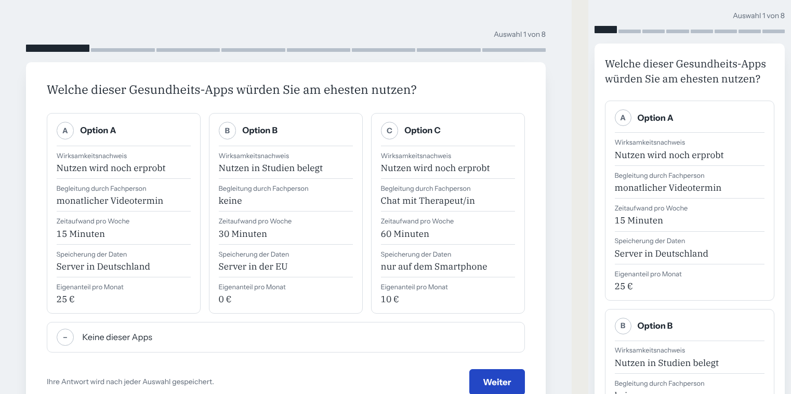
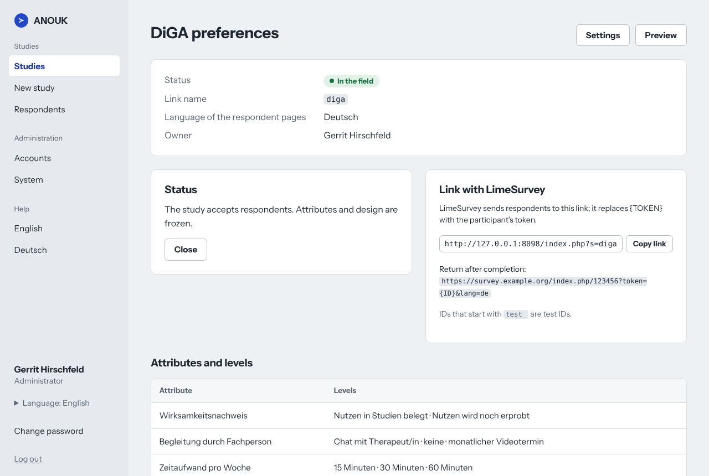
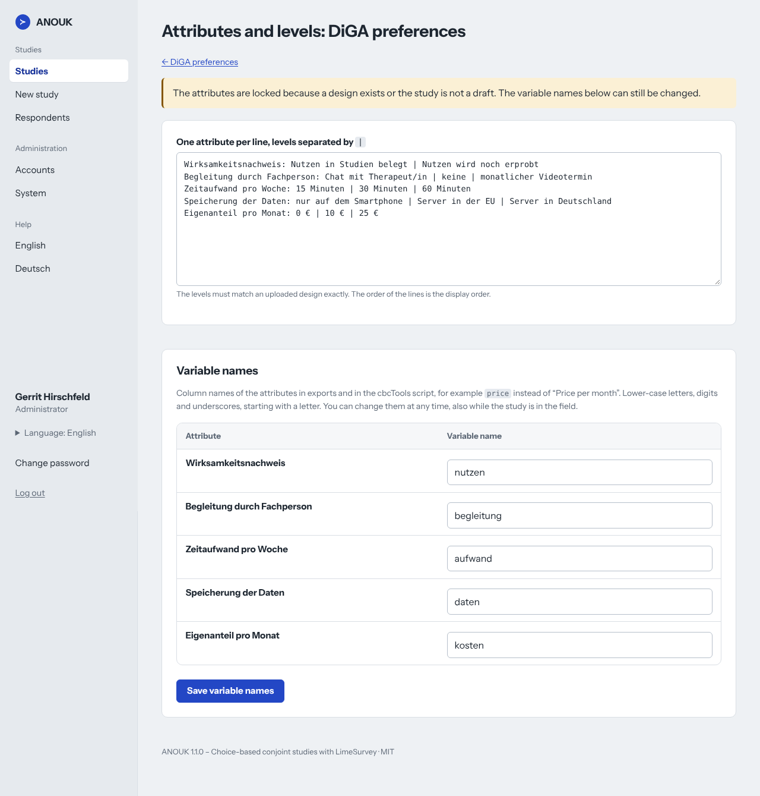

# ANOUK – choice-based conjoint studies for LimeSurvey and other survey tools

 

**A**uswahlbasierte **N**utzenmessung: **O**nline-**U**msetzung & **K**alkulation (choice-based utility measurement: online presentation and calculation). ANOUK shows respondents the choice tasks of a choice-based conjoint (CBC) study whose choice sets were designed in R with `cbcTools`. Respondents come from a survey tool such as LimeSurvey with their ID, answer the choice tasks and return to the same survey. ANOUK runs on ordinary shared web hosting with PHP and MySQL.

Deutsche Fassung: `README.de.md`



## Features

- **Choice sets from R:** ANOUK writes a `cbcTools` script from the attributes of a study; the resulting CSV is uploaded and checked line by line
- **Survey tools:** respondents arrive with their ID from LimeSurvey, SoSci Survey, Unipark or Qualtrics and are sent back with the same ID
- **Versions:** each new ID gets the least-used version of the design; versions of drop-outs become free again after a set time
- **Exports:** long format for `logitr`, `mlogit` and `bayesm`, wide format to merge with the survey data, and a codebook
- **Variable names:** short, R-friendly column names per attribute (`price` instead of “Price per month”), changeable at any time
- **Accounts:** an administrator plus any number of project leaders, who each see only their own studies
- **Languages:** admin area and respondent pages in English and German; more languages by adding one file
- **Updates:** database changes of new versions run with one click; no shell needed

## Requirements

- PHP 8.1 or newer with `pdo_mysql` and `mbstring`
- MySQL 5.7+ or MariaDB 10.3+
- Standard shared hosting (Apache) is sufficient – no shell access, Composer or Node.js needed
- HTTPS is strongly recommended

## Installation (shared hosting)

1. Download the latest release ZIP from the Releases page and unzip it.
2. Upload the folder via FTP, e.g. to `https://your-domain.org/anouk/`. Upload the `.htaccess` files too (they are hidden files).
3. Create an empty MySQL database in your hosting control panel and note host, name, user and password. The database may also contain tables of other software.
4. Open `https://your-domain.org/anouk/install.php` and follow the steps:
   - enter the database details and click **Test connection** – the page reports whether the connection works, whether the user may create tables and whether an ANOUK database exists already;
   - keep the **table prefix** `anouk_` unless you run two ANOUK installations in one database;
   - enter name, e-mail address and password (at least 10 characters) of the administrator and click **Install**;
   - write down the **emergency code** shown on the success page.
5. Delete `install.php` from the server (the success page has a button for this).
6. Log in at `https://your-domain.org/anouk/admin/`.

If the installer cannot write `config.php`, it shows the content of the file; create it by FTP next to `index.php`. After the installation, the file `data/install.lock` locks the installer.

### nginx

nginx ignores `.htaccess` files. Add these rules to the server block (adjust `/anouk/` to your folder):

```
location ~ ^/anouk/(src|sql|data|lang|tests)/ { deny all; }
location ~ ^/anouk/(config\.php|.*\.md|.*\.cff|LICENSE)$ { deny all; }
```

Even without these rules, `config.php` and the PHP files in `src/` print nothing when requested.

### Resetting the configuration

To set ANOUK up again, for example after the database password changed, `config.php` is deleted. Studies, accounts and answers stay in the database; the installer recognises the existing database.

- **As administrator:** *System → Delete config.php* (this needs `install.php` on the server).
- **Without logging in**, for example when the database can no longer be reached: open `install.php` and enter the emergency code.
- **By FTP:** delete `config.php` and `data/install.lock`.

## Updating

1. Back up the database (e.g. with phpMyAdmin of your host) and `config.php`.
2. Upload the new files. Do not overwrite `config.php` and the folder `data/`, and do not upload `install.php` again.
3. Log in as administrator. If the new version changes the database, the *System* page offers **Update database**. Until you click it, respondents see a maintenance notice, so update right after uploading.

**From version 1.0.x:** the admin area has moved to `admin/` (old bookmarks are forwarded). After uploading, delete the old folders `app/` and `examples/` and the old files `assets/style.css`, `assets/admin.js`, `assets/survey.js`, `assets/favicon.svg` and `assets/fonts/`.

## Usage



### Creating a study

**Studies → New study**

- **Title** is shown in the admin area only.
- **Link name** gives the entry link `index.php?s=link-name`. It cannot be changed later.
- **Language of the respondent pages:** English or German.

A study is a **draft** until you send it into the field. Only drafts can change attributes and design. **In the field** it accepts respondents; **closed** it does not. A study can go back to draft as long as nobody has answered.

**Settings** of a study: the question above each task, an introduction, a **none option** (“None of these”), random attribute order per respondent, return and error URL (see below), the release time for versions of drop-outs, and the prefix of test IDs (default `test_`).

### Attributes and variable names

Under *Attributes and levels*, enter one attribute per line, the levels separated by `|`:

```
Price per month: 0 € | 10 € | 25 €
Data storage: on the phone | server in Germany | server in the EU
```

The order of the lines is the order on the respondent pages; the labels appear exactly as written.

Below, every attribute gets a **variable name**: the column name in the exports and in the R script, for example `price` for “Price per month”. ANOUK suggests one (lower case, underscores, no umlauts); you can change it at any time, also while the study is in the field.



### Creating choice sets with cbcTools

Under *Design*, ANOUK writes an R script with the attributes and levels of the study. You choose the `cbcTools` method that needs no prior assumptions (`minoverlap`, recommended; `balanced`, `shortcut` or `random`), the number of versions, sets per version and alternatives per set, and optionally a seed. Run the script in R (`cbcTools` 0.7 or newer: `install.packages("cbcTools")`) and upload the CSV it writes.

For D-efficient designs with priors, change the script to `method = "cea"` or `"modfed"` with `cbc_priors()`. Do not add a “no choice” option in `cbcTools`; switch on the none option in ANOUK instead.

**Example:** `docs/examples/diga` contains a complete study on digital health applications (DiGA) with an R script and a ready-made design to try out.

### Uploading a design

The CSV file has one row per version × task × alternative and one column per attribute:

```
respID,qID,altID,price,storage
1,1,1,10 €,on the phone
1,1,2,25 €,server in the EU
```

- Columns are matched by the attribute's label or its variable name. If no attributes are defined yet, they are taken from the file.
- `respID`, `qID` and `altID` from `cbcTools` (or `version`, `task`, `alt`) are recognised; `profileID`, `obsID`, `blockID` and `choice` are ignored; no-choice rows are removed.
- Comma, semicolon and tab are recognised; files saved as Windows-1252 are converted; numbering is renumbered from 1.

A file is stored only if every row is valid. Otherwise the page lists the problems with line numbers (unknown levels, missing values, unequal numbers of tasks or alternatives, identical alternatives, repeated tasks). The study page shows level frequencies and overlap of the stored design. For quick tests without R, ANOUK can also generate a simple design itself.

### Respondents

Each respondent gets the version with the fewest completed (and recently active) respondents; test IDs do not count. Answers are stored immediately; a respondent who comes back with the same ID continues at the next open task, and a completed ID is sent straight back. After the first page the ID is held in a session cookie and disappears from the address bar.

*Studies → Respondents* lists all respondents with status and answers and lets you delete single respondents. *Preview* on the study page runs through the study without storing anything.

### Linking with LimeSurvey (and other survey tools)

The study page shows the **entry link**:

```
https://your-domain.org/anouk/index.php?s=diga&id=…
```

In the study settings, the **return URL** leads back to the survey. Placeholders: `{ID}` = the respondent's ID, `{STATUS}` = `complete`. The optional **error URL** is used when the study is not in the field (`{STATUS}` = `closed`) or the ID is invalid (`invalid_id`).

**IDs that start with the test prefix** (default `test_`) run through normally but do not count for the version assignment and are left out of the export unless chosen.

> Please run through the whole chain with a test ID before the field phase – survey tools change their settings from version to version.

**LimeSurvey.** Run the survey with a participant list (tokens) and switch on token-based response persistence, so LimeSurvey continues the started response. Send respondents to ANOUK from a question page (not through the end URL, which completes the response), for example with a link in a question of type *Text display*:

```
Entry link:  https://your-domain.org/anouk/index.php?s=diga&id={TOKEN}
Return URL:  https://survey.example.org/index.php/123456?token={ID}&lang=en
```

**SoSci Survey.** On the page before the choice tasks, add PHP code that sends the respondent to ANOUK with the interview token; the second argument `true` keeps the interview open:

```
redirect('https://your-domain.org/anouk/index.php?s=diga&id=' . caseToken(), true);
```

```
Return URL:  https://www.soscisurvey.de/YOUR-PROJECT/?i={ID}
```

**Unipark (EFS Survey).** In the primary project, add a page of type *External survey start* with the entry link `https://your-domain.org/anouk/index.php?s=diga` as destination and *Add return ticket* ticked. EFS passes its ticket as `tic`; ANOUK accepts `tic` as the ID. As return URL, use your project's address with `ospe.php`:

```
Return URL:  https://ww3.unipark.de/uc/YOUR-PROJECT/ospe.php?return_tic={ID}
```

**Qualtrics.** Qualtrics cannot continue a finished response, so split the survey into two parts. Part 1 ends with *Redirect to a URL* (End of Survey element; needs a licensed account), part 2 captures `id` as embedded data in its survey flow:

```
End of part 1:  https://your-domain.org/anouk/index.php?s=diga&id=${e://Field/ResponseID}
Return URL:     https://YOUR-ORG.qualtrics.com/jfe/form/SV_PART2?id={ID}
```

The lower-case placeholders `{id}` and `{status}` of ANOUK 1.0 still work.

### Exporting data

The study page offers three CSV files, each for completed respondents only or including drop-outs, with or without test IDs, in **R style** (comma) or **German Excel style** (semicolon, UTF-8 with BOM). All times are UTC in ISO 8601 (`2026-11-19T08:01:00Z`).

**Long format** – one row per ID × task × alternative:

| Column | Content |
|---|---|
| `id` | ID from the survey tool |
| `obs_id` | running number per ID × task (the choice situation) |
| `version`, `task`, `alt` | position in the design |
| one column per attribute | the level shown, named by the variable name |
| `none` | with a none option only: 1 in the extra row for “none of these” (`alt` = J + 1, attributes empty) |
| `choice` | 1 = chosen, else 0 |
| `rt_ms`, `screen_w` | response time in milliseconds and window width in pixels |
| `answered_at` | time of the answer |
| `status`, `is_test` | `active` or `complete`; test ID 1/0 |

**Wide format** – one row per ID, to merge with the survey data: `id`, `version`, `status`, `is_test`, `n_answered`, `started_at`, `completed_at`, then `choice_t01`, `choice_t02`, … (the chosen alternative; 0 = none option, empty = not answered) and `rt_t01`, `rt_t02`, … (response times in ms).

**Codebook** – one row per column of both formats with `variable`, `label`, `type` and `values` (for attributes: the levels in their defined order).

### Reading the data in R

```r
d <- read.csv("anouk_diga_long_20261119.csv", encoding = "UTF-8")
```

`docs/r/read_anouk.R` reads all exports in either style, converts the times and, with the codebook, turns the attributes into factors in the defined level order. Example with `logitr`:

```r
source("read_anouk.R")
d <- read_anouk("anouk_diga_long_20261119.csv", codebook = "anouk_diga_codebook_20261119.csv")

library(logitr)
m <- logitr(data = d, outcome = "choice", obsID = "obs_id",
            pars = c("wirksamkeitsnachweis", "begleitung_durch_fachperson",
                     "zeitaufwand_pro_woche", "speicherung_der_daten",
                     "eigenanteil_pro_monat", "none"))
summary(m)

w <- read_anouk("anouk_diga_wide_20261119.csv")              # one row per ID
all <- merge(survey_data, w, by.x = "token", by.y = "id")     # with the LimeSurvey data
```

With a none option, `read_anouk()` fills the empty attribute cells of the none rows with the reference level, so `none` is estimated as a parameter of its own. Leave out `none` if the study has no none option.

## Accounts and roles

| | Administrator | Project leader |
|---|---|---|
| Create studies, create and upload designs, export | yes | yes |
| Studies of other accounts | all | none |
| Create, edit, deactivate and delete accounts | yes | no |
| System page (database update, installer, configuration) | yes | no |

Under *Accounts*, the administrator creates project leaders; ANOUK shows a starting password once, which the person has to change at the first login. ANOUK sends no e-mails; for a forgotten password the administrator creates a new starting password. Deleting an account first transfers its studies to another account. A project leader who opens a study of another account gets “not found”.

After five failed logins for the same e-mail address from the same connection, ANOUK makes the person wait 1, 2, 4, 8 and then 15 minutes before the next try.

## Data protection

**What ANOUK stores:** the ID passed by the survey tool, the assigned version, the answers with response time and window width, and timestamps.

**What it does not store:** IP addresses, browser details, names or e-mail addresses of respondents. The one exception concerns the admin login: to slow down password guessing, failed logins are counted per salted hash of e-mail address and IP address. The hashes cannot be turned back into addresses and are deleted after 24 hours.

**Cookies:** one session cookie per study with a random token, and the PHP session cookie (both HttpOnly, SameSite=Lax, deleted when the browser closes). They are technically necessary (§ 25 Abs. 2 Nr. 2 TDDDG). The database stores only a SHA-256 hash of the token.

**No third parties:** fonts and scripts are part of ANOUK; nothing is loaded from other servers, and `Referrer-Policy: no-referrer` stops addresses from being passed on.

**Hosting:** the access logs of your host contain the entry link including the ID. Record the processing agreement with the host and its log retention in your data protection documentation.

**Deletion:** find a respondent by ID under *Respondents* and use *Delete respondent*. *Delete all answers* empties a study; *Delete study* removes it with design and answers for good.

## Security

- Delete `install.php` after installation; `data/install.lock` locks it in any case.
- `src/`, `sql/`, `data/`, `lang/`, `tests/` and `config.php` are blocked by `.htaccess` files (nginx: see above).
- Passwords are stored as bcrypt hashes; admin forms are protected against cross-site requests; admin sessions end after four hours without activity (`admin_idle_minutes` in `config.php`).
- Anyone who knows the entry link of a study in the field can start it with an invented ID. Such rows are recognisable because their ID is not in the participant list of your survey; remove them when merging.
- The Excel-style export puts an apostrophe in front of cells that start with `=`, `+`, `-` or `@`, so a spreadsheet shows them instead of running them. The R-style export stays exact.
- A Content-Security-Policy forbids inline scripts and anything from other servers.
- Tick “Always use HTTPS” during installation (`force_https` in `config.php`).

## Languages

English and German are included, for the admin area and the respondent pages. The admin area follows the browser language at first; everyone can switch it in the menu, and the choice is stored with the account. The language of the respondent pages is set per study.

To add a language, copy `lang/en.php` to, for example, `lang/fr.php`, set `'_name' => 'Français'` and translate the texts on the right-hand side. ANOUK offers every file in `lang/` automatically. `php tests/i18n.php` lists missing translations.

## Troubleshooting

| Problem | Solution |
|---|---|
| “Database not reachable” | Check the access data in `config.php`, or reset the configuration (see above) |
| Respondents see “being updated” | Log in as administrator and click *Update database* under *System* |
| “Installer locked” | Delete `data/install.lock` by FTP if you really want to install again |
| “The form has expired” | Cookies are blocked, or the page was open too long: reload it |
| Upload fails without a message | The file exceeds the host's PHP `upload_max_filesize` |
| Umlauts are garbled | Save the CSV as “CSV UTF-8” |
| Show PHP errors | Set `'debug' => true` in `config.php`, temporarily |

## Development and tests

The tests use SQLite and need no MySQL server:

```
php tests/run.php      # logic: parser, generator, exports, migrations, throttling
php tests/i18n.php     # every text exists in every language file
bash tests/e2e.sh      # complete run over HTTP (PHP built-in server + Python 3)
```

```
index.php        respondent pages (entry link)
admin/           admin area
install.php      installer (delete after use)
src/             logic and templates (blocked)
lang/            language files
sql/             database schema and migrations (blocked)
data/            lock file (blocked)
assets/          stylesheet, fonts, scripts, icon
docs/            example study, R function, screenshots
tests/           tests with SQLite
```

The layout comes from the sister project [JUST-CAT](https://github.com/gerhi/just-cat) (adaptive tests for LimeSurvey). Changes are listed in `CHANGELOG.md`.

## Citation

See `CITATION.cff` or the “Cite this repository” button on GitHub.

## License

MIT – see `LICENSE`. The bundled fonts (Instrument Sans, IBM Plex Serif) are under the SIL Open Font License 1.1 (`assets/css/fonts`).

## Contact

Gerrit Hirschfeld, Hochschule Bielefeld (HSBI) – issues and pull requests welcome.
